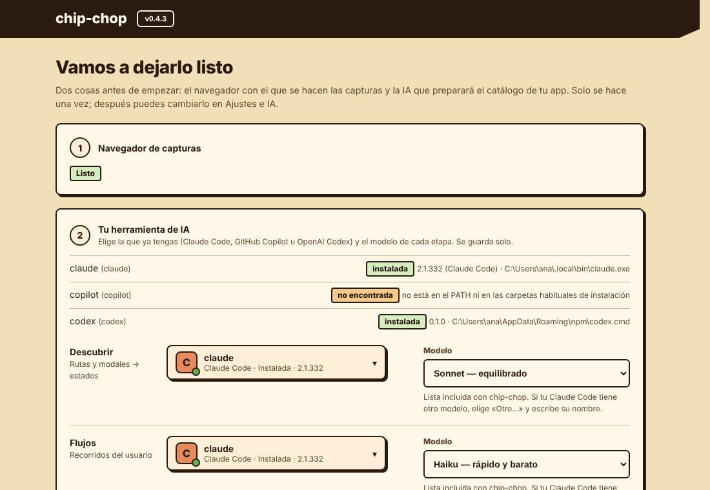
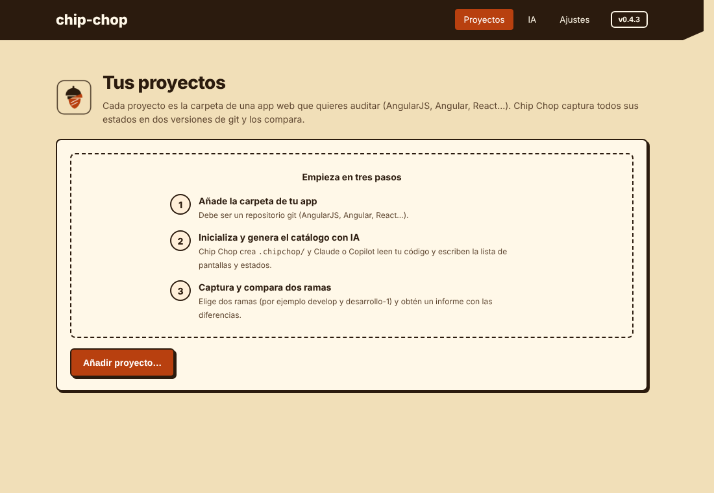
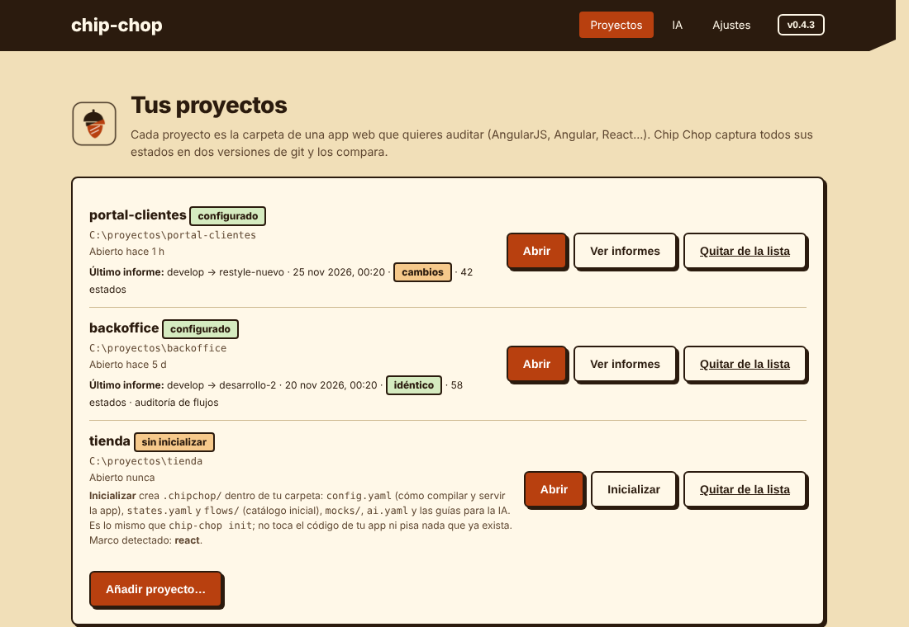
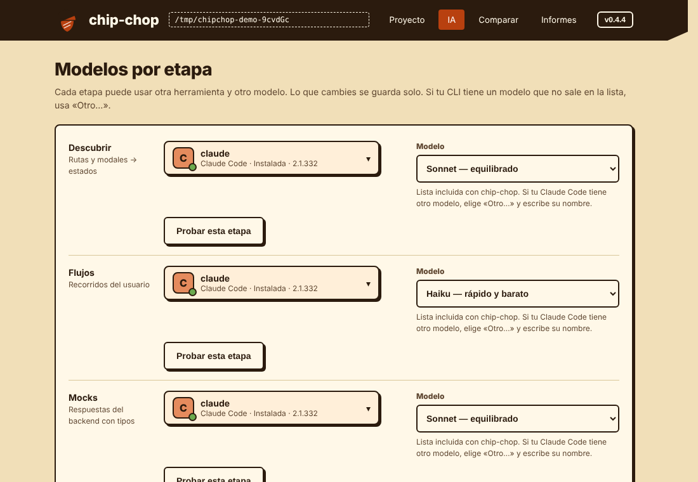
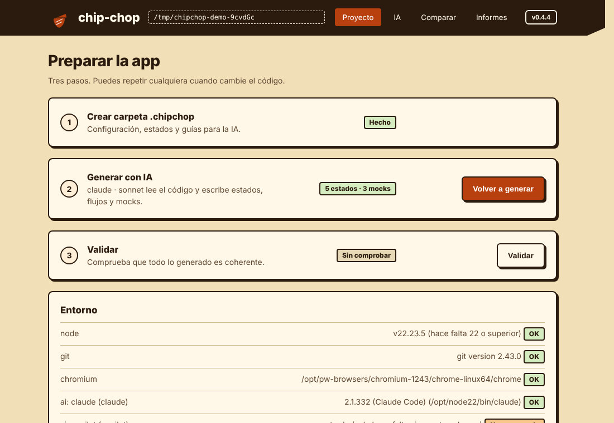
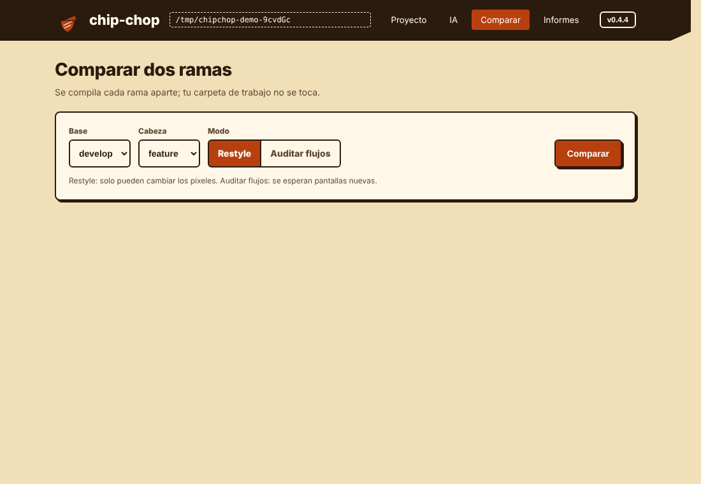
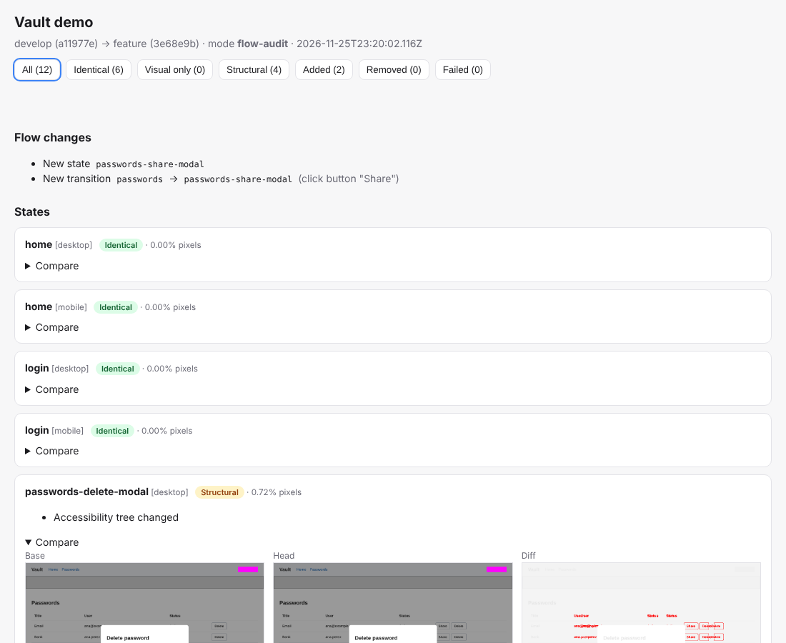
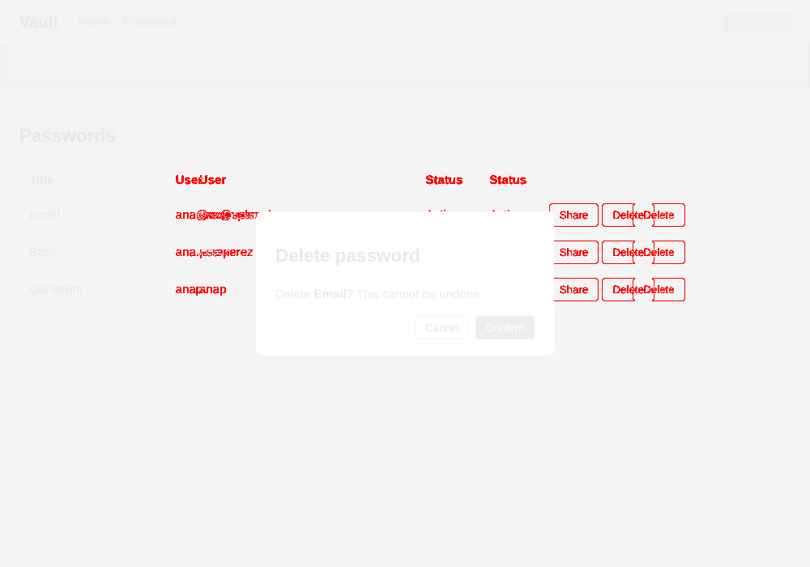
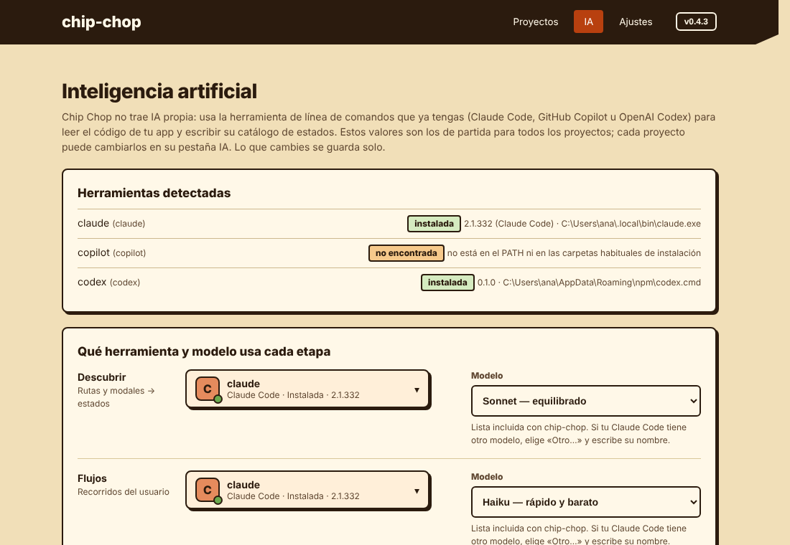
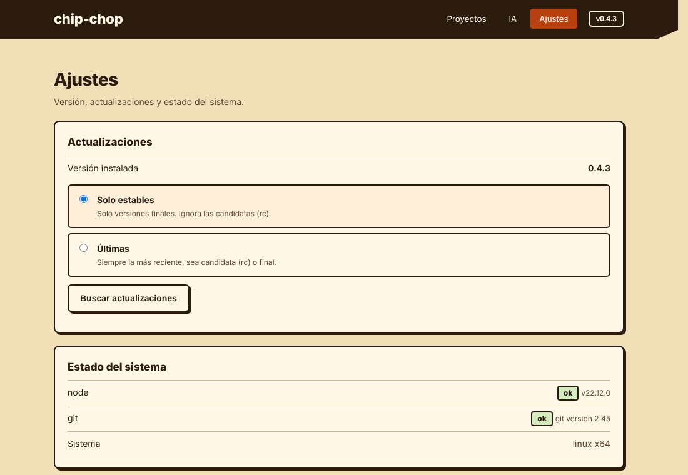

<p align="center">
  
</p>

# chip-chop

**Captura cada pantalla de tu app web en dos versiones de git y dime qué ha cambiado de verdad.**

chip-chop construye tu app en dos ramas (por ejemplo `develop` y `restyle-nuevo`), recorre **todos sus estados** (páginas, modales, pestañas, errores…) con un navegador real y compara píxeles, árbol de accesibilidad, peticiones, errores de consola y el grafo de flujos. Una IA (Claude CLI, Copilot CLI u otra) lee tu código y prepara el catálogo de estados; después todo es determinista y no necesita backend.

Funciona con **cualquier app web** (AngularJS, Angular, React…): el framework solo importa para que la IA lea tu código.

- [Para qué sirve](#para-qué-sirve)
- [Instalar](#instalar)
- [El flujo en un vistazo](#el-flujo-en-un-vistazo)
- [Guía paso a paso](#guía-paso-a-paso)
- [La carpeta `.chipchop/`](#la-carpeta-chipchop)
- [Línea de comandos](#línea-de-comandos)
- [La app de escritorio](#la-app-de-escritorio)
- [Actualizaciones y canales](#actualizaciones-y-canales)
- [Preguntas frecuentes](#preguntas-frecuentes)
- [Qué está probado y qué no](#qué-está-probado-y-qué-no)
- [Desarrollo y releases](#desarrollo-y-releases)

## Para qué sirve

| Quiero… | Modo | Qué exige |
|---|---|---|
| **Rehacer el aspecto sin romper nada** | `restyle` | Los píxeles pueden cambiar; el árbol ARIA, las peticiones y el grafo de pantallas **no**. |
| **Auditar una rama que añade o quita pantallas** | `flow-audit` | Te dice qué estados se han añadido, quitado o cambiado, lado a lado y con diff. |
| **Documentar una app** | cualquiera | El catálogo de estados y flujos es documentación viva de cada pantalla y recorrido. |

## Instalar

Descarga el instalable de tu sistema en la [última release](https://github.com/ElMaxter99/chip-chop/releases/latest):

| Sistema | Archivo | Notas |
|---|---|---|
| Windows | `chip-chop-*-win-x64.exe` | Instalador. SmartScreen avisará: no está firmado. |
| macOS | `chip-chop-*-mac-arm64.dmg` / `-x64.dmg` | **Nunca probado en un Mac real.** Gatekeeper avisará: no está firmado. |
| Linux | `.AppImage`, `.deb`, `.rpm` | El AppImage se actualiza solo; `.deb`/`.rpm` abren la página de descargas. |
| Terminal (sin ventana) | `chip-chop-*-linux.tar.gz`, `-windows.zip`, `-macos.tar.gz` | Trae `install.sh` / `install.ps1`; da el comando `chip-chop`. |

Necesitas **git** y **Node 22 o superior** en el PATH para la línea de comandos. La app de escritorio ya trae lo que necesita y descarga Chromium la primera vez (se muestra el progreso en la pantalla de Inicio).

Para que la IA prepare el catálogo necesitas **una** de estas herramientas con sesión iniciada (Claude Code, GitHub Copilot CLI u OpenAI Codex):

```bash
# Claude Code
curl -fsSL https://claude.ai/install.sh | bash          # Windows: irm https://claude.ai/install.ps1 | iex
# GitHub Copilot CLI
npm install -g @github/copilot                          # Windows: winget install GitHub.Copilot
# OpenAI Codex (ChatGPT)
npm install -g @openai/codex && codex login
```

Comprueba que todo está bien con `chip-chop doctor` (o en **Ajustes** de la app).

## El flujo en un vistazo

```
 leer el código ─▶ catálogo ─▶ capturar (rama A) ─┐
  (IA + guía)      estados,     mocks, PNG, ARIA,  ├─▶ comparar ─▶ informe
                   flujos,      peticiones         │   píxeles       HTML + JSON
                   mocks      capturar (rama B) ───┘   ARIA/peticiones + Markdown
                                                      grafo de flujos
```

1. **Preparar**: la IA lee tu código y escribe `.chipchop/` dentro de tu app (estados, flujos, mocks).
2. **Validar**: el motor comprueba esos ficheros contra los JSON Schema; lo mal formado se rechaza.
3. **Capturar**: se compila y sirve cada rama aparte (tu carpeta de trabajo no se toca), cada llamada a la API se responde con los mocks (sin backend, login incluido), se congelan el reloj y las animaciones y se guarda captura, ARIA y peticiones de cada estado.
4. **Comparar**: los estados se emparejan por `id` (`passwords-delete-modal` en una rama contra el mismo `id` en la otra); una pantalla nueva es un `id` nuevo.
5. **Revisar**: informe HTML con filtros, diff de píxeles y cambios de flujo.

## Guía paso a paso

### 0. Abre la app

La primera vez la app te hace una **configuración inicial**: descarga el navegador de capturas (con su progreso) y te pide elegir tu herramienta de IA y el modelo de cada etapa. Se guarda sola y, cuando todo está bien, pulsas **Empezar** (o «Configurar la IA más tarde»).



Después ves **Inicio**: tus proyectos, el uso de IA y los ajustes. Al principio está vacío; **Añadir proyecto…** (o arrastra una carpeta encima, o pásala como argumento al ejecutable de la app).



Cada proyecto es la carpeta de una app web. La lista muestra si está configurado, cuándo lo abriste y el resultado de su último informe.



### 1. Inicializa el proyecto

En un proyecto *sin inicializar* pulsa **Inicializar** (o ejecuta `chip-chop init` en la carpeta). Crea `.chipchop/` con `config.yaml`, un catálogo inicial y las guías para la IA. No toca el código de tu app ni pisa nada que ya exista. Detecta el framework; puedes forzarlo con `--framework angularjs|angular|react|other`.

Abre `.chipchop/config.yaml` y revisa **cómo se compila y se sirve tu app** (comando de build, directorio de salida o servidor, puerto, viewports). Es lo único que casi siempre hay que tocar a mano.

### 2. Deja que la IA prepare el catálogo

Pestaña **IA** (lo que cambies se guarda solo y lo confirma un aviso): elige la herramienta (Claude Code, Copilot u OpenAI Codex; se ve cuál está instalada y dónde) y el modelo de cada etapa (descubrir estados, flujos, mocks, reparar). El modelo sale de una lista —la de Copilot se lee de `copilot help`; la de Claude va incluida— y siempre puedes escribir otro con «Otro…». Puedes mezclar, p. ej. un modelo potente para descubrir y uno barato para los flujos. chip-chop busca las herramientas en el PATH, en el PATH del sistema y en las carpetas habituales de instalación; si aun así no la encuentra, indica la ruta completa en `command:` de `ai.yaml`.



**Probar esta etapa** abre una ventana que explica qué hace (localiza el programa, le manda una petición mínima sin permisos de escritura ni de comandos y comprueba la respuesta), muestra el tiempo y el resultado, y qué comando se ejecutó. Si la herramienta o el modelo elegido dejan de estar disponibles, chip-chop **no lanza la IA** y te lleva a esta pestaña para que lo dejes bien.

Por terminal: `chip-chop ai test claude` comprueba que el CLI responde y `chip-chop ai run` ejecuta las etapas. Con `--dry-run` imprime los comandos sin ejecutarlos. La configuración global vive en `~/.chipchop/ai.yaml` y cada proyecto puede sobrescribirla con su `.chipchop/ai.yaml`.

Después ejecuta `chip-chop validate`: comprueba configuración, estados, flujos y mocks entre sí. Es barato; úsalo siempre que edites algo a mano.

### 3. Revisa el estado del proyecto

La pestaña **Proyecto** («Preparar la app») son tres pasos que puedes repetir cuando cambie el código —crear `.chipchop`, generar con IA y validar— y, debajo, el **entorno** (node, git, Chromium y los CLI de IA).



### 4. Compara dos ramas

Pestaña **Comparar**: elige **Base** y **Cabeza** y el modo (`restyle` o `auditar flujos`). Se compila cada rama en un directorio temporal; tu carpeta de trabajo no cambia.



Equivale a:

```bash
chip-chop compare --base develop --head restyle-nuevo --mode restyle
```

Si ya capturaste, `--reuse` salta la captura. `capture` captura una sola rama (`--ref`, `--label`, `--only a,b`, `--viewport mobile`).

### 5. Lee el informe

Cada comparación deja un informe HTML (más JSON y Markdown) en `.chipchop/reports/`. Se abre desde la pestaña **Informes**; `chip-chop report` lo vuelve a generar a partir de una comparación existente.



Cada estado sale con una etiqueta:

| Etiqueta | Significa |
|---|---|
| **Identical** | Idéntico en píxeles, ARIA y peticiones. |
| **Visual only** | Solo cambian los píxeles (lo esperado en un `restyle`). |
| **Structural** | Cambia el árbol de accesibilidad, las peticiones o hay errores nuevos de consola. En `restyle` es lo que hay que investigar. |
| **Added / Removed** | El estado solo existe en una rama (lo esperado en `flow-audit`). |
| **Failed** | No se pudo capturar en alguna rama. |

Abre **Compare** en cada estado para ver *Base*, *Head* y el *Diff*; arriba están los cambios de flujo (estados y transiciones nuevos).



La página completa de ejemplo: [`docs/screenshots/report-full.png`](docs/screenshots/report-full.png).

### 6. Repite

Cambia el código, vuelve a comparar. Para ver el grafo de pantallas: `chip-chop graph` (Mermaid). Si la IA se equivocó en un flujo o un mock, edítalo a mano o relanza solo esa etapa con `chip-chop ai run flows`.

## La carpeta `.chipchop/`

Vive dentro de la app auditada y se versiona con ella.

```
.chipchop/
  config.yaml            compilación, servidor, viewports, determinismo, auth, assets externos
  states.yaml            cada estado capturable: páginas, modales, paneles, pestañas
  flows/*.flow.yaml      recorridos de usuario, legibles y generados por la IA
  mocks/**/*.mock.json   respuestas tipadas del backend, un fichero por escenario
  ai.yaml                (opcional) proveedores y modelos de este proyecto
  runs/  reports/        salida generada (ignorada por git)
```

Un flujo se lee así:

```yaml
id: passwords-delete
title: Borrar una contraseña
mocks: [auth/login-ok, passwords/list-with-data]
steps:
  - goto: /#!/passwords
  - capture: passwords
  - click: { role: button, name: "Delete" }
  - capture: passwords-delete-modal
  - press: Escape
```

Los mocks se infieren del código (interfaces, DTO, esquemas Zod, fixtures de tests), llevan un `responseSchema` y se validan contra él: un `isActive` booleano no puede convertirse en texto sin que salte. Ejemplos completos en [`packages/schemas/examples`](packages/schemas/examples).

En apps **AngularJS** chip-chop espera a que `$http` y `$browser` queden en reposo antes de capturar; en todas, congela animaciones y reloj para que dos capturas iguales den cero diferencias.

## Línea de comandos

```
chip-chop init        crea .chipchop/ en la app actual
chip-chop validate    comprueba configuración, estados, flujos y mocks
chip-chop capture     compila y sirve una referencia git y captura cada estado
chip-chop compare     captura dos referencias y escribe el informe
chip-chop report      vuelve a generar HTML/Markdown de una comparación existente
chip-chop graph       imprime el grafo de flujos (Mermaid)
chip-chop ai          ai run [etapas] | ai test <proveedor> | ai show
chip-chop ui          abre la app local en el navegador
chip-chop doctor      comprueba node, git, Chromium y los CLI de IA
chip-chop update      update [--check] | update channel [stable|latest]
```

Opciones comunes: `--dir <carpeta>`, `--base/--head <ref>`, `--mode restyle|flow-audit`, `--reuse`, `--only a,b`, `--viewport <nombre>`, `--no-install`, `--keep-worktree`. Guía completa: [docs/USAGE.md](docs/USAGE.md).

## La app de escritorio

Es la misma interfaz que `chip-chop ui`, con Inicio, gestor de proyectos y actualizaciones automáticas. Además:

- **Recuerda** tamaño y posición de la ventana.
- **Avisa** con una notificación del sistema cuando termina una captura, comparación o tarea de IA si estabas en otra ventana.
- **Arrastra** una carpeta sobre Inicio para añadirla, o ábrela desde el terminal pasándola como argumento.
- **Pregunta** antes de cerrar si hay tareas en marcha.
- Menú *Archivo ▸ Inicio* (`Ctrl/⌘+H`) y botón «‹ Inicio» dentro de cada proyecto.

Pestañas de Inicio: **Proyectos**, **IA** (qué proveedor y modelo usa cada etapa) y **Ajustes** (versión, canal de actualización, Chromium, comprobaciones).




## Actualizaciones y canales

La app avisa cuando hay una versión nueva y la instala sola en Windows y en el AppImage de Linux; en macOS, `.deb` y `.rpm` abre la página de descargas. Por terminal: `chip-chop update --check` y `chip-chop update`.

| Canal | Qué recibes |
|---|---|
| `stable` («Solo estables») | Solo versiones finales. Es el predeterminado. |
| `latest` («Últimas») | También las *release candidates* (`-rc.N`); la final gana siempre a su RC. |

Cámbialo en **Ajustes** o con `chip-chop update channel latest`. Los borradores nunca cuentan.

## Preguntas frecuentes

**¿Necesito un backend?** No. Cada llamada a la API se responde con los mocks del catálogo, login incluido.

**¿Toca mi código o mi carpeta de trabajo?** No. Cada rama se construye en un `git worktree` temporal; `init` solo crea `.chipchop/`.

**¿Y si no uso IA?** Puedes escribir `states.yaml`, los flujos y los mocks a mano; la IA solo los genera más rápido. `validate` te ayuda a acertar.

**¿Qué framework necesito?** Ninguno en concreto. Hay guías para AngularJS, Angular y React en [`packages/skills`](packages/skills).

**Dos capturas iguales dan diferencias.** Mira si la app usa fuentes o imágenes externas (decláralas en `config.yaml`), reloj o animaciones propias, o datos aleatorios; `chip-chop doctor` y `docs/USAGE.md` lo detallan.

**La app de escritorio no abre / no descarga Chromium.** Ejecuta `chip-chop doctor`; si estás tras un proxy, descarga Chromium por terminal con tu configuración de red.

## Qué está probado y qué no

Probado en CI (Linux y Windows): motor, CLI, interfaz, demos de AngularJS y estática, actualizador contra releases simuladas y arranque del paquete de escritorio.

**Sin probar** (no lo des por hecho): el proveedor de OpenAI Codex y la lectura de modelos de `copilot help` (solo con tests unitarios); la configuración inicial de la app de escritorio (solo con datos de ejemplo); macOS en un Mac real; instalar a mano el `.exe`, el `.dmg`, el `.deb`/`.rpm`/AppImage; notificaciones, arrastrar y soltar y memoria de ventana más allá de arrancar; la IA con Claude CLI y Copilot CLI de extremo a extremo; apps reales de Angular y React. Los instalables **no están firmados**.

## Desarrollo y releases

| Ruta | Contenido |
|---|---|
| `packages/core` | El paquete `chip-chop`: motor, CLI, proveedores de IA, servidor local y UI |
| `packages/schemas` | JSON Schemas de configuración, estados, flujos, mocks e informes, con ejemplos |
| `packages/skills` | `SKILL.md` y guías para AngularJS, Angular, React, estados/flujos y mocks |
| `desktop` | App de escritorio (Electron) e instaladores |
| `examples` | Apps de demostración (estática, AngularJS, Angular, React) |
| `docs` | [USAGE](docs/USAGE.md), [ARCHITECTURE](docs/ARCHITECTURE.md), [ROADMAP](docs/ROADMAP.md), [RELEASING](docs/RELEASING.md) |

```bash
npm install && npm run build
npm run typecheck && npm test && npm run test:scripts && npm run test:e2e --workspace chip-chop
npm run docs:check          # enlaces, imágenes y capturas del README al día
```

Cada cambio de usuario lleva su fragmento en `changelog/unreleased/` (ver [changelog/README.md](changelog/README.md)). **Cada versión actualiza esta documentación**: el workflow *Docs screenshots* regenera `docs/screenshots/` con la interfaz real y `npm run docs:check -- --strict` bloquea la release si el README apunta a algo que no existe o las capturas se hicieron con otra interfaz. El procedimiento completo está en [docs/RELEASING.md](docs/RELEASING.md).

Relacionado: [pdf-annotator](https://github.com/ElMaxter99/pdf-annotator), de donde se tomó el flujo de releases.

Licencia [MIT](LICENSE).
